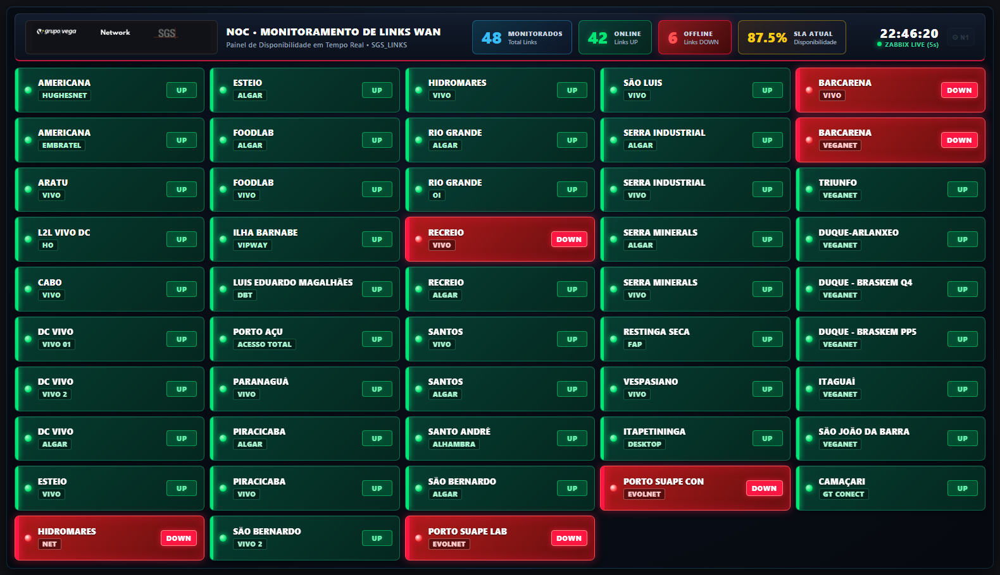
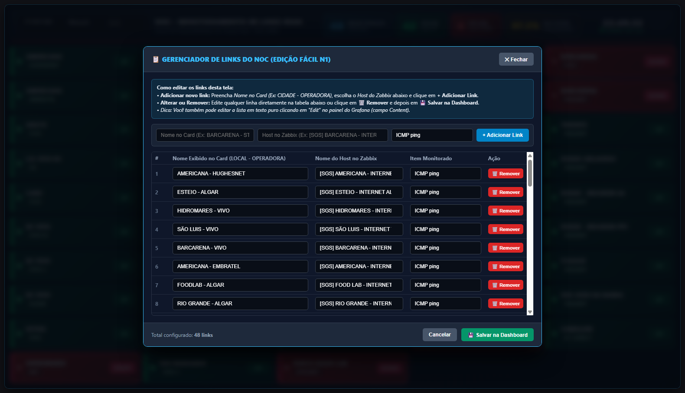
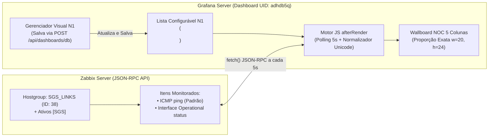

# 🌐 Grafana Links NOC Wallboard (Zabbix WAN Status)

[](https://grafana.com/)
[](https://www.zabbix.com/)
[](https://grafana.com/grafana/plugins/marcusolsson-dynamictext-panel/)
[](LICENSE)
[](https://github.com/IDhexter/Grafana-Links)

Uma solução completa de **Wallboard Passivo para NOC (Network Operations Center)** no **Grafana**, integrada em tempo real à API JSON-RPC do **Zabbix** para monitoramento visual de disponibilidade (`UP` / `DOWN`) de dezenas de links WAN, MPLS, Fibra e Satélite em uma única tela sem barras de rolagem.

Projetado especificamente para exibição contínua em **TVs e Video Walls de NOC**, mantendo **proporção geométrica exata (`gridPos: w=20, h=24`)** e oferecendo um **Gerenciador Visual N1 integrado** para que analistas de Nível 1 possam adicionar, remover ou renomear links sem tocar em código.

---

## 📸 Demonstração Visual

### 1. Visão Geral do Wallboard NOC (48 Links em Matriz 5×10 • Proporção `w=20, h=24`)


### 2. Gerenciador Visual Integrado para Manutenção Fácil pelo N1 (`⚙ N1`)


---

## 🌟 Principais Recursos

1. **Estética Industrial de NOC (Leitura Passiva a Longa Distância)**:
   * **Cabeçalho Executivo de Comando**: Exibe o logotipo institucional (`grupo vega | Network | SGS`), contadores gigantes de **Links Monitorados (`48`)**, **Online (`42`)**, **Offline (`6`)**, **SLA de Disponibilidade (`87.5%`)** e **Relógio Digital em Tempo Real** com indicador de sincronismo `ZABBIX LIVE (5s)`.
   * **Separação Visual Automática (`Localidade` + `Operadora`)**: Cada card divide automaticamente o texto `UNIDADE - OPERADORA` em um título principal branco de alto contraste (Unidade/Site) e um crachá inferior (Operadora: `VIVO`, `ALGAR`, `VEGANET`, `EMBRATEL`, `HUGHESNET`, `EVOLNET`, etc.).
   * **Destaque Visual Crítico para Links `DOWN`**:
     * **Links `UP` (`1`)**: Superfície verde-esmeralda escura com barra lateral neon `#00e676`, LED verde luminoso e badge `UP`.
     * **Links `DOWN` (`0`)**: Superfície vermelho-carmesim viva com borda e halo luminoso pulsante (`@keyframes nocDownPulse`), LED vermelho piscante e badge de alarme `DOWN`.

2. **Proporção Exata Travada para TV do NOC (`gridPos: x=0, y=0, w=20, h=24`)**:
   * Utiliza `grid-template-columns: repeat(5, minmax(0, 1fr))` e `grid-auto-rows: 1fr` dentro de um container flexbox que normaliza automaticamente as `<div>` internas do Grafana (`.panel-content`).
   * **Zero Rolagem / Zero Corte**: Independentemente de haver 45, 48, 50 ou 55 links configurados, as linhas se auto-ajustam milimetricamente para caber em 100% da altura da TV do NOC.

3. **Duplo Sistema de Manutenção Fácil para o N1**:
   * **Modo Visual (`⚙ N1`)**: Botão discreto no canto superior direito que abre uma janela administrativa com autocompletar de todos os hosts do grupo `SGS_LINKS` do Zabbix, permitindo adicionar, remover ou renomear links e salvar diretamente no banco de dados do Grafana (`POST /api/dashboards/db`).
   * **Modo Texto Puro (`Edit ➔ Content`)**: O campo `Content` do painel contém apenas a lista limpa de links (`LOCALIDADE - OPERADORA | HOST NO ZABBIX | ITEM OPCIONAL`), sem código HTML/CSS misturado.

4. **Monitoramento Híbrido (`ICMP ping` + Interfaces SNMP)**:
   * Por padrão, consulta o item `ICMP ping` de cada host no grupo `SGS_LINKS` (`Group ID: 38`) ou com prefixo `[SGS]`.
   * Permite especificar uma interface SNMP dedicada no 3º parâmetro da linha (ex.: `Interface 1/47(L2L-VIVO-CRS-500MB): Operational status` em um Switch Core Aruba) para monitorar túneis L2L ou portas físicas específicas.

---

## 🏗️ Arquitetura de Funcionamento



---

## 📋 Pré-Requisitos

1. **Zabbix Server (6.0 / 6.4 / 7.0+)**:
   * Hosts de links WAN cadastrados preferencialmente no grupo **`SGS_LINKS`** (`Group ID: 38`) com monitoramento `ICMP ping` ativo.
   * Token de API do Zabbix com permissão de leitura nos grupos de links.
2. **Grafana (10+ / 11+ / 12+)**:
   * Plugin **Business Text (`marcusolsson-dynamictext-panel`)** instalado:
     ```bash
     grafana-cli plugins install marcusolsson-dynamictext-panel
     ```
   * Logotipo institucional opcional em `/public/img/logos/Network_SGS.png` (incluso em [`assets/Network_SGS.png`](assets/Network_SGS.png)).

---

## 🚀 Como Reproduzir / Instalar o Painel do Zero

### Opção 1: Deploy Automatizado via PowerShell (Recomendado)

1. **Clone este repositório**:
   ```bash
   git clone https://github.com/IDhexter/Grafana-Links.git
   cd Grafana-Links
   ```

2. **Configure o arquivo `.env`**:
   ```powershell
   Copy-Item .env.example .env
   ```
   Edite o arquivo `.env` com os dados do seu ambiente:
   ```ini
   ZABBIX_URL="http://10.10.1.26/api_jsonrpc.php"
   ZABBIX_TOKEN="seu_token_api_zabbix"
   GRAFANA_URL="http://10.10.1.25:3000"
   GRAFANA_USER="seu_usuario_grafana"
   GRAFANA_PASSWORD="sua_senha_grafana"
   GRAFANA_DASHBOARD_UID="adhdb5q"
   ```

3. **Execute o script de compilação e publicação**:
   ```powershell
   powershell -ExecutionPolicy Bypass -File scripts\build_sgs_links_noc.ps1
   ```
   O script consulta o estado atual de todos os links no Zabbix, gera o cache inicial Zero-Flash e publica a dashboard pronta no Grafana.

---

### Opção 2: Importação Manual do JSON no Grafana

1. Baixe o arquivo [`grafana/dashboards/sgs_links_status_noc.json`](grafana/dashboards/sgs_links_status_noc.json).
2. No Grafana, acesse **Dashboards ➔ New ➔ Import** e envie o arquivo JSON.
3. Clique em **Edit** no painel e, no código **After Content Ready (`afterRender`)**, substitua:
   * `http://{{ZABBIX_HOST}}/api_jsonrpc.php` pela URL da API do seu Zabbix.
   * `{{ZABBIX_API_TOKEN}}` pelo seu token da API do Zabbix.
4. Salve a dashboard.

---

## 🛠️ Guia de Manutenção para o N1 (Adicionar, Remover e Editar Links)

> 📘 **Documentação dedicada para a equipe do NOC**: Consulte o [**Manual de Operação e Manutenção N1 (`docs/MANUAL_MANUTENCAO_N1.md`)**](docs/MANUAL_MANUTENCAO_N1.md).

### Resumo Rápido para o N1:

#### 1. Usando o Gerenciador Visual (`⚙ N1`) na Própria Tela:
1. Passe o mouse no canto superior direito da dashboard (ao lado do relógio) e clique em **`⚙ N1`**.
2. **Para Adicionar**: Preencha `CIDADE - OPERADORA`, selecione o `Host no Zabbix` na lista autocompletável e clique em **`+ Adicionar Link`**.
3. **Para Editar ou Remover**: Altere qualquer texto diretamente na tabela ou clique em **`🗑️ Remover`**.
4. Clique em **`💾 Salvar na Dashboard`** para gravar permanentemente no Grafana.

#### 2. Usando o Modo `Edit` do Grafana (Texto Puro):
No painel do Grafana (**Edit ➔ Content**), cada linha corresponde a um card na tela:

```text
# Formato: LOCALIDADE - OPERADORA | NOME DO HOST NO ZABBIX | ITEM (Opcional, padrão: ICMP ping)
AMERICANA - HUGHESNET         | [SGS] AMERICANA - INTERNET HUGHESNET
ESTEIO - ALGAR                | [SGS] ESTEIO - INTERNET ALGAR
HIDROMARES - VIVO             | [SGS] HIDROMARES - INTERNET VIVO
L2L VIVO DC - HO              | [SGS] - Switch DC CORE - ARUBA | Interface 1/47(L2L-VIVO-CRS-500MB): Operational status
```

---

## ⚠️ Notas Técnicas Importantes para Manutenção Avançada

1. **Codificação UTF-8 com BOM no PowerShell 5.1**:
   * O Windows PowerShell 5.1 lê scripts `.ps1` sem BOM como `Windows-1252 (ANSI)`, o que corrompe acentos (`SÃO LUÍS`, `PORTO AÇU`, `PARANAGUÁ`) e impede o casamento de nomes com a API do Zabbix.
   * Mantenha sempre o arquivo `scripts/build_sgs_links_noc.ps1` salvo em **UTF-8 with BOM**.
2. **Here-Strings Simples (`@' ... '@`) para JavaScript**:
   * O código `afterRender` utiliza Template Literals do ES6 (crases `` ` `` e `${variavel}`). No PowerShell, delimite blocos JavaScript exclusivamente com `@' ... '@` (aspas simples) para evitar que o PowerShell tente interpolar variáveis do JS como `$null`.
3. **Filtro de `hostids` no `item.get` do Zabbix**:
   * Nunca execute `item.get` procurando por `"ICMP ping"` sem passar o array `hostids` dos hosts desejados; filtrar por `hostids` reduz o tempo de resposta da API do Zabbix de ~8 segundos para **menos de 80ms**.

---

## 📂 Estrutura do Repositório

```text
├── assets/
│   ├── sgs_noc_wallboard.png            # Captura em alta definição do Wallboard NOC em produção
│   ├── sgs_noc_n1_editor.png            # Captura do Gerenciador Visual N1 aberto
│   └── Network_SGS.png                  # Logotipo oficial do cabeçalho NOC
├── docs/
│   └── MANUAL_MANUTENCAO_N1.md          # Manual passo a passo para analistas N1/N2 do NOC
├── grafana/
│   └── dashboards/
│       └── sgs_links_status_noc.json    # Dashboard JSON exportada e sanitizada para importação direta
├── scripts/
│   ├── build_sgs_links_noc.ps1          # Script gerador e publicador automatizado via API
│   └── export_sanitized_dashboard.ps1   # Script de exportação e sanitização de credenciais
├── .env.example                         # Modelo de variáveis de ambiente
├── .gitignore                           # Proteção de arquivos sensíveis (.env)
├── LICENSE                              # Licença MIT
└── README.md                            # Documentação principal
```

---

## 📄 Licença

Distribuído sob a licença [MIT](LICENSE).

---

**Desenvolvido por [IDhexter](https://github.com/IDhexter)**  
*Observabilidade Avançada de Redes, NOC Wallboards, Zabbix & Grafana.*
